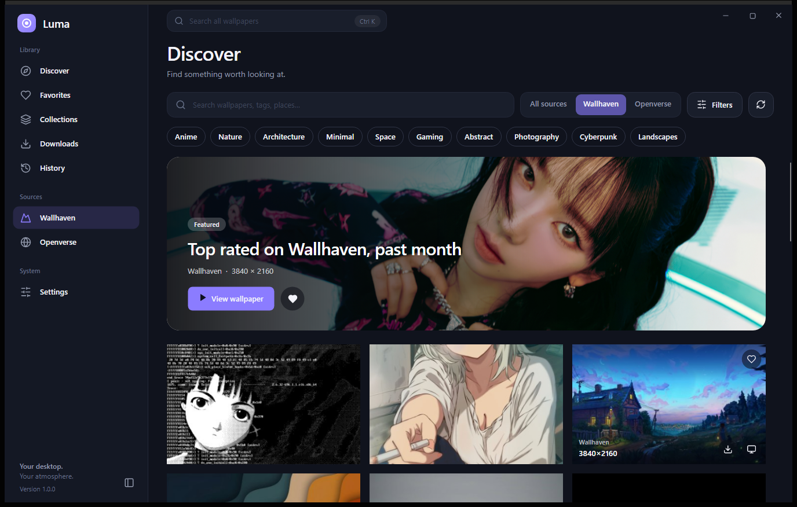
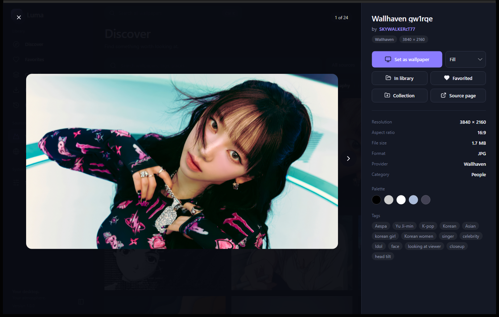
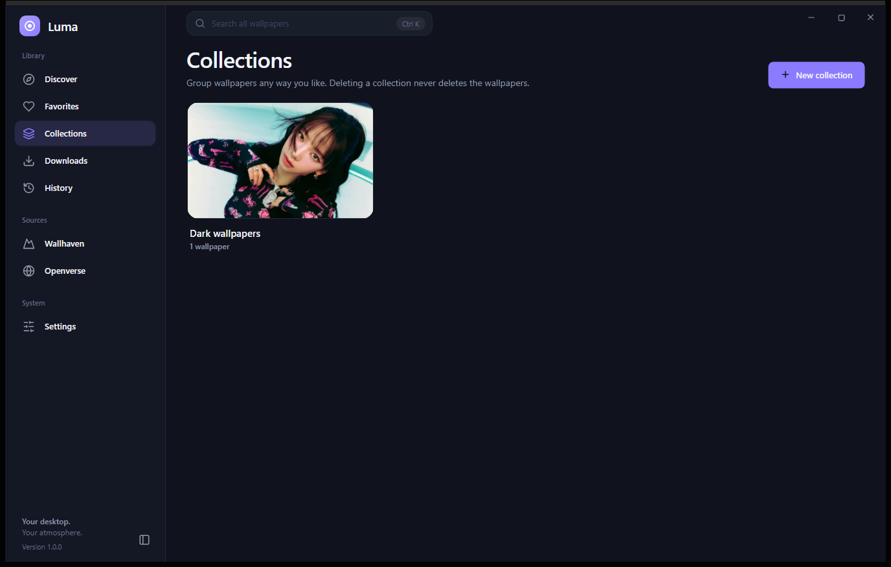
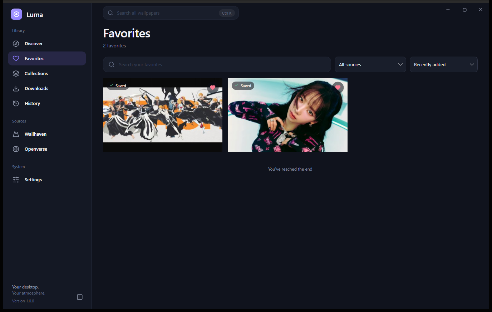
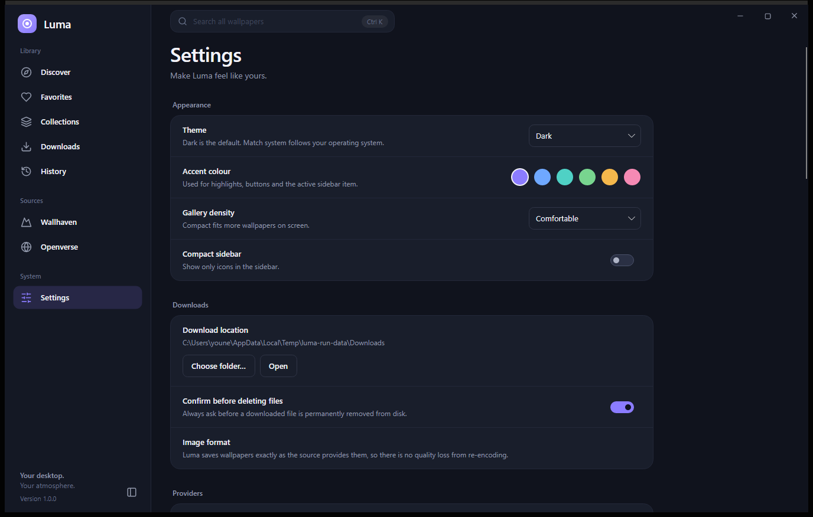

# Luma

**Your desktop. Your atmosphere.**

Luma is a lightweight, personal desktop wallpaper manager. Discover wallpapers from several online sources, preview
them in full quality, download them, organise them into collections, keep favourites and apply them straight to your
desktop. It is a native desktop application built with C#, .NET 11 and Avalonia UI: no Electron, no browser wrapper,
no backend server.



| Preview | Collections |
|---|---|
|  |  |

| Favorites | Settings |
|---|---|
|  |  |

## Features

- **Discover**: live results from **Wallhaven** and **Openverse**, one source or all at once, debounced search,
  category shortcuts, provider-aware filters (sort, categories, purity, resolution, aspect ratio, colour, content type,
  license), infinite scrolling with a real "Load more" fallback, loading skeletons, empty and error states with retry.
  A failing provider never hides results from the other one.
- **Preview**: shows the cached thumbnail instantly, then one larger image (decoded to at most 2400 px); details
  (uploader, tags, palette) are fetched from the provider, license and attribution are shown where required.
  `←` / `→` move through the gallery, `Esc` closes.
- **Apply wallpapers** on Windows (all six fit modes) and on Linux (GNOME, Cinnamon, MATE, KDE Plasma, XFCE, Sway, or
  any X11 session with `feh`). macOS reports honestly that it is not supported.
- **Downloads and local library**: bounded concurrent downloads with progress and cancel, validation of the received
  file (real image header check, never trusting the Content-Type), duplicate detection (by wallpaper and by content
  hash), safe file names, disk-full and permission errors explained in plain language, importing existing images,
  show in folder, "remove from library" vs. "delete file" (with confirmation). Everything stays usable offline.
- **Favorites**: independent of downloading, stored with full metadata so they survive a provider being offline;
  search, filter by source, sort.
- **Collections**: create, edit, delete, add and remove wallpapers, mosaic covers. Deleting a collection never deletes
  wallpapers or files.
- **History** of applied wallpapers with one-click re-apply (consecutive duplicates are merged).
- **Automatic rotation** (while Luma is running) through downloaded wallpapers, favourites or a collection, random or
  sequential, never repeating the current wallpaper while alternatives exist. Missing files are skipped.
- **Themes**: dark (default), light and "match system", six accent colours, comfortable/compact gallery density,
  collapsible sidebar. Keyboard shortcuts: `Ctrl+K` global search, `Ctrl+F` page search, `Ctrl+,` settings,
  `Ctrl+R` / `F5` refresh, `Esc` closes the preview or dialog.

## Technology

| Area | Choice |
|---|---|
| Runtime / language | .NET 11 (SDK 11.0.100), C# |
| UI | Avalonia 12.1.6 (Fluent theme as a base, custom design tokens, Inter font, Lucide-style icons) |
| MVVM | CommunityToolkit.Mvvm 8.4 |
| Data | SQLite + EF Core 11 with migrations |
| HTTP | `IHttpClientFactory` named clients |
| DI / config / logging | Microsoft.Extensions.* and Serilog (rolling file sink) |
| Tests | xUnit (132 tests) |

## Architecture

```
src/
  Luma.Core/            Models, enums, interfaces, pure logic (no Avalonia, no I/O frameworks)
  Luma.Infrastructure/  EF Core, repositories/services, providers, downloads, thumbnail cache, platform adapters
  Luma.App/             Avalonia views, view models, controls, styles, app services
  Luma.Tests/           Unit, integration and fake-based platform tests
```

- `Luma.Core` depends on nothing UI related. Providers implement `IWallpaperProvider`; the UI only knows the neutral
  `Wallpaper`, `WallpaperSearchQuery`, `WallpaperSearchResult` and `WallpaperProviderCapabilities` types.
- View models never touch HTTP or SQLite; they use services (`IFavoritesService`, `ICollectionService`,
  `IDownloadLibrary`, `IDownloadService`, `IHistoryService`, ...). Platform behaviour sits behind `IWallpaperApplier`,
  `IShellLauncher`, `IProcessRunner` and `IPlatformInfo`.
- Pages are singletons whose views are cached, so navigation keeps scroll position and state.
- `WallpaperGrid` is a responsive, virtualised grid: wallpapers are laid out in rows that match the window width and
  the rows are the virtualised items. `ThumbnailImage` loads lazily while attached to the visual tree and releases its
  bitmap and cancels the request when it scrolls away.
- `ImageLoader` decodes straight to the display width (`Bitmap.DecodeToWidth`), limits decoding to three parallel jobs,
  keeps an LRU cache bounded by item count and bytes, and never disposes a bitmap that is still leased by a control.
  `ImageFetcher` adds a bounded-concurrency network pipeline with in-flight de-duplication, cancellation when nobody
  waits any more, and a size-limited on-disk cache with least-recently-used eviction.

## Prerequisites

- **.NET 11 SDK** (11.0.100 or newer). `global.json` pins the SDK feature band.
- Windows 10/11 or a Linux desktop. Nothing else: no database server, no Node.js.

## Build, run, test

```powershell
dotnet restore
dotnet build -c Release
dotnet test -c Release
dotnet run -c Release --project src/Luma.App
```

Create a distributable build (framework-dependent, needs the .NET 11 runtime on the target machine):

```powershell
./scripts/publish.ps1            # -> artifacts/Luma-win-x64/Luma.exe
./scripts/publish.ps1 -Runtime linux-x64
```

Use `-SelfContained` to bundle the runtime.

## Providers

### Wallhaven

Official API v1 (`https://wallhaven.cc/api/v1/`, docs: <https://wallhaven.cc/help/api>). Supported: search,
pagination (24 per page), sorting (relevance, date added, views, favourites, top list with range, random with seed),
categories, purity, minimum resolution, aspect ratios, one colour, wallpaper details (uploader, tags), previews and
original URLs. Limits: 45 requests per minute; Luma stays under 40 with a client-side limiter and treats HTTP 429 as
"blocked until Retry-After" without retrying. NSFW needs an API key; without one Luma never requests it.

**API key**: Settings → Providers → *Wallhaven API key*. It is stored in `settings.json` in your data folder and is
sent only as the `X-API-Key` header (never in a URL, never logged).

### Openverse

Official API (`https://api.openverse.org/v1/`). Supported: image search, pagination, thumbnails, original URLs, creator,
source, license name and URL, attribution text. Filters: aspect ratio, a coarse size bucket (any minimum resolution maps
to Openverse's "large"), content type (photograph / illustration / digitized artwork), license type, sort by newest.
Openverse content is not curated for wallpapers and is not unrestricted: the license is shown in the preview and Luma
tells you to credit the creator.

Anonymous limits (verified against the live API): **20 requests/minute, 200/day, and at most 240 results per search**.
Luma stops paginating at that depth. To lift the limits, register an application with Openverse and enter the client ID
and secret in Settings → Providers; Luma uses the documented OAuth2 client-credentials flow and caches the token.
Some Openverse thumbnails are unavailable from the provider's thumbnail service; Luma then falls back to the original
only if it is small (≤ 1.2 MB), otherwise the card shows "Preview unavailable".

Not integrated on purpose: Unsplash and Pexels (their terms do not clearly authorise wallpaper applications), Steam
Workshop (would require scraping). Luma uses official APIs only.

### Adding another provider

1. Implement `IWallpaperProvider` in `Luma.Infrastructure/Providers` (see `OpenverseProvider` for a compact example).
   Map the API payload to `Wallpaper`, expose honest `WallpaperProviderCapabilities`, throw `ProviderException` with a
   `ProviderErrorKind` for failures, and reuse `ProviderHttp` and `RequestGate` for error handling and rate limiting.
2. Register an `HttpClient` name and the provider in `DependencyInjection.cs`.
3. Add its enable switch to `ProviderRegistry.IsEnabled` and `AppSettings`, and a toggle in `SettingsViewModel`.
4. Add mocked-HTTP tests like those in `ProviderTests.cs`. The Discover page, filters and library adapt automatically
   to the capabilities you declare.

## Wallpaper application engine

`IWallpaperApplier` applies an image file that already exists on disk. `WallpaperApplyService` downloads first when
needed, validates the path, converts formats Windows cannot use (WebP/GIF → PNG via Avalonia), applies, and records
history only on success.

- **Windows**: writes the documented `WallpaperStyle` / `TileWallpaper` values and calls `SystemParametersInfo(SPI_SETDESKWALLPAPER)`
  with `SPIF_UPDATEINIFILE | SPIF_SENDCHANGE`. Fill, Fit, Stretch, Tile, Center and Span. The return value is checked:
  Luma only reports success when Windows accepted the change.
- **Linux**: detects the desktop from `XDG_CURRENT_DESKTOP` / session type and runs the native tool *without a shell*
  (argument lists only, paths validated): `gsettings` (GNOME family, Cinnamon, MATE; sets the dark-mode URI too),
  `plasma-apply-wallpaperimage` (KDE; no fit modes), `xfconf-query` (XFCE, every monitor), `swaymsg` (Sway) and `feh`
  (X11). **Limitations**: Wayland compositors without a standard wallpaper API are reported as unsupported; Sway and
  `feh` backgrounds last for the session; KDE ignores the fit mode. This is covered by fake-runner tests, not by a
  real Linux desktop (Luma was developed and verified on Windows).
- **macOS**: not implemented; Luma says so instead of pretending.

### Adding a platform adapter

Implement `IWallpaperApplier` (declare `Capabilities` honestly), then return it from `CreateApplier` in
`DependencyInjection.cs`. Validate paths with `WallpaperPathValidator` and run external tools through `IProcessRunner`
so the adapter stays unit-testable with a fake.

## Data storage

Everything lives in the OS application-data folder (override with the `LUMA_DATA_DIR` environment variable):

```
%LOCALAPPDATA%\Luma\                  (Linux: ~/.local/share/Luma)
  luma.db            SQLite database (metadata, favourites, collections, library, history)
  settings.json      Settings
  Cache\Thumbnails\  Disk thumbnail cache (size-limited, clearable in Settings)
  Downloads\         Default download folder (changeable in Settings)
  Logs\              Rolling logs (14 days)
```

The database stores metadata and file paths, never image bytes. Migrations are applied automatically and never drop
existing data. The API key is stored as plain text in `settings.json` (protected by your user profile permissions);
it is never logged or put in a URL.

## Performance

Measured on the development machine (Windows 11, 1376×876 window, default settings, Wallhaven source), reading process
counters without forcing garbage collection. "Private WS" is Windows' *private working set*, which is what Task
Manager shows as "Memory". "Working set" also counts pages shared with the runtime and system DLLs.

| Scenario | Private WS | Working set | Target |
|---|---:|---:|---:|
| Idle (Discover loaded) | 58 MB | 170 MB | < 120 MB |
| Normal browsing (about 80 wallpapers scrolled) | 109 MB | 226 MB | < 200 MB |
| Heavy browsing (hundreds of wallpapers, many pages) | 126 MB | 247 MB | < 250 MB |

By Task Manager's metric all three targets are met. By the *total working set* the idle and normal figures are above
the targets (the extra is shared runtime pages); heavy browsing is just under. This is measured, not assumed, and it
depends on the machine.

What keeps it low: lazy, cancellable thumbnail loading; thumbnails decoded to display width; virtualised rows; a bounded
LRU decode cache (default 80 thumbnails ≈ 30 MB); bounded decode and HTTP concurrency; single preview image; and the
default **Efficient** renderer. GPU rendering costs roughly 100 MB more (idle private WS ≈ 165 MB vs 65 MB); switch it
in Settings → Performance → Graphics if you prefer smoother animation on very high resolution displays.
Set `LUMA_MEMLOG=1` to write a memory sample to the log every 4 seconds.

Start-up shows the window first; the database opens afterwards and Discover only calls the network once it is visible.

## Known limitations

- Rotation only runs while Luma is running (no background service or start-up registration).
- Applying wallpapers is verified on Windows. Linux support is implemented and unit-tested with fakes only.
- Openverse anonymous access is limited (see above) and some Openverse thumbnails are unavailable.
- Wallhaven's API does not provide wallpaper titles, so untitled wallpapers are shown as "Wallhaven *id*".
- "Default image format" is intentionally not offered: wallpapers are saved exactly as provided (no re-encoding).
- Light/dark switching and accent changes apply live, the **Graphics** mode applies after a restart.
- The API key and Openverse client secret are stored unencrypted in `settings.json`.

## License

Personal project. Wallpapers belong to their creators; respect each provider's terms and each image's license.
